# API specification

- Base URL: `http://127.0.0.1:8080`
- JSON requests: `Content-Type: application/json`
- Authenticated requests: `Authorization: Bearer <access_token>`

Interactive request files: [Orch HTTP tests](../orch-user-access/tests/http/README.md).

## Endpoints

| Method | Path | Auth | Request | Success: `data` |
|---|---|---|---|---|
| POST | [`/api/v1/users`](#register) | Public | `name`, `email`, `password` | 201: `{user: User, tokens: Tokens}` |
| POST | [`/api/v1/sessions`](#login) | Public | `email`, `password` | 201: `Tokens` |
| GET | [`/api/v1/users/me`](#current-profile) | Bearer | — | 200: `User` |
| GET | [`/api/v1/users/{id}`](#get-user) | Bearer | — | 200: `User` |
| GET | [`/api/v1/users`](#list-users) | Bearer | Query: `limit`, `after` | 200: `{users: User[], next_cursor?: string}` |
| PATCH | [`/api/v1/users/{id}`](#update-user) | Owner | `name` and/or `email` | 200: `User` |
| DELETE | [`/api/v1/users/{id}`](#delete-user) | Owner | — | 204: no body |
| POST | [`/api/v1/sessions/current/tokens`](#refresh) | Refresh token | `refresh_token` | 200: `Tokens` |
| DELETE | [`/api/v1/sessions/current`](#logout) | Bearer | — | 204: no body |
| GET | [`/healthzc`](#liveness) | Public | — | 200: `{status: "alive"}` |
| GET | [`/readyz`](#readiness) | Public | — | 200: `{status: "ready"}`; 503 if unavailable |

`/healthz` aliases `/healthzc`. Registration sets `Location: /api/v1/users/{id}`; login sets `Location: /api/v1/sessions/current`.

## Fields

| Field | Rule |
|---|---|
| `id`, `after` | 32 hexadecimal characters |
| `name` | Required on registration; 1–100 characters; trimmed; no control characters |
| `email` | Required on registration/login; valid email; at most 254 UTF-8 bytes; trimmed and lowercased |
| `password` | Registration: 12–72 UTF-8 bytes; login: required, at most 72 bytes |
| `limit` | 1–100; default 20 |
| PATCH body | At least one of `name`, `email`; missing fields stay unchanged; null-only patches are invalid |

JSON body limit: 16 KiB. Unknown fields and trailing JSON are rejected. `next_cursor` is omitted on the final page.

## Response examples

Registration, HTTP 201:

```json
{
  "data": {
    "user": {
      "id": "0123456789abcdef0123456789abcdef",
      "name": "Alice",
      "email": "alice@example.com",
      "created_at": "2026-11-06T00:00:00Z",
      "updated_at": "2026-11-06T00:00:00Z"
    },
    "tokens": {
      "access_token": "<access_token>",
      "refresh_token": "<refresh_token>",
      "token_type": "Bearer",
      "expires_at": "2026-11-06T00:15:00Z",
      "user_id": "0123456789abcdef0123456789abcdef"
    }
  }
}
```

`User` is the object under `user`; `Tokens` is the object under `tokens`. Get/PATCH return `{"data": User}`; login/refresh return `{"data": Tokens}`.

Empty list, HTTP 200:

```json
{"data":{"users":[]}}
```

Error, HTTP 401:

```json
{"error":{"code":"unauthorized","message":"invalid credentials or token"}}
```

| HTTP | Error code | Meaning |
|---|---|---|
| 400 | `invalid_request` | Invalid input |
| 401 | `unauthorized` | Invalid credentials or token |
| 403 | `forbidden` | Ownership violation |
| 404 | `not_found` | User or route missing |
| 405 | `method_not_allowed` | Unsupported method |
| 409 | `conflict` | Email already registered |
| 429 | `session_limit` | Active session limit reached |
| 500 | `internal_error` | Internal failure |
| 503 | `service_unavailable` | Dependency unavailable |
| 504 | `timeout` | Request deadline exceeded |

## Sequence diagrams

`Orch` = orch-user-access; `Auth` = core-authentication; `User` = core-user-manage. All calls are synchronous. Error responses stop the flow; later messages are not executed. Unless a branch is shown, arrows describe the success path. Dependency failures return 503; deadlines return 504.

Payload validation finishes before business RPCs. Protected GET/PATCH routes authenticate before validating handler fields; DELETE validates its target ID before owner authorization. Every REST request carries request/trace IDs and an eight-second request deadline.

Examples use these values from a registration/login response:

```sh
BASE=http://127.0.0.1:8080
ACCESS_TOKEN='<access_token>'
REFRESH_TOKEN='<refresh_token>'
USER_ID='<user_id>'
```

### Shared authentication for protected GET/PATCH

Used by profile, get-user, list and update. A missing/malformed Bearer header returns 401 before the Auth RPC.

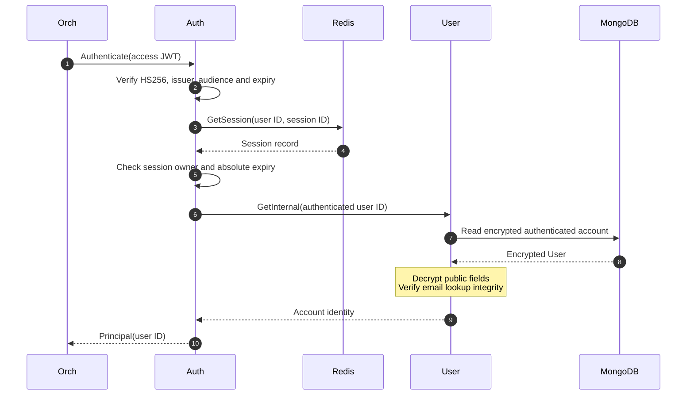

| Failure | Result |
|---|---|
| Invalid/expired JWT; missing, expired or mismatched session | 401; stop before account/profile lookup |
| Authenticated account deleted | 401; stop before the requested user operation |
| Redis/User RPC failure or deadline | 503/504; no operation is executed |

<a id="register"></a>

### POST /api/v1/users — Register

**Request:** `{name, email, password}`. **Response:** 201, `data: {user: User, tokens: Tokens}`; `Location: /api/v1/users/{id}`. **Errors:** 400 input, 409 duplicate email, 429 session limit, 503/504 dependency failure.

```sh
curl -i "$BASE/api/v1/users" -H 'Content-Type: application/json' \
  -d '{"name":"Alice","email":"alice@example.com","password":"correct-horse-battery"}'
```

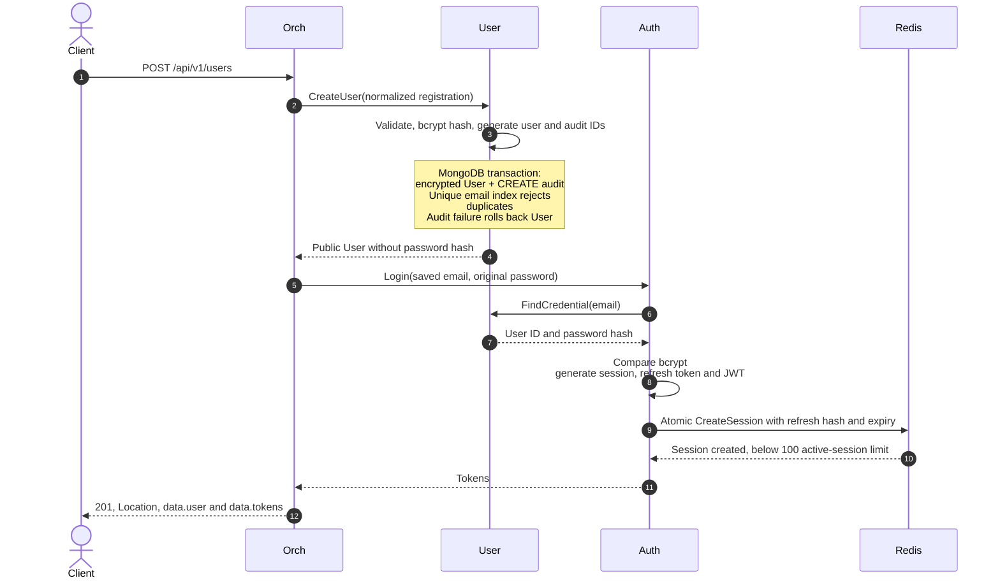

If login/session creation fails after the User transaction commits, the account remains. Use the login endpoint; repeating registration returns 409. Tokens are returned only after Redis accepts the session.

<a id="login"></a>

### POST /api/v1/sessions — Login

**Request:** `{email, password}`. **Response:** 201, `data: Tokens`; `Location: /api/v1/sessions/current`. **Errors:** 400 malformed input, 401 credentials, 429 active-session limit, 503/504 dependency failure.

```sh
curl -i "$BASE/api/v1/sessions" -H 'Content-Type: application/json' \
  -d '{"email":"alice@example.com","password":"correct-horse-battery"}'
```

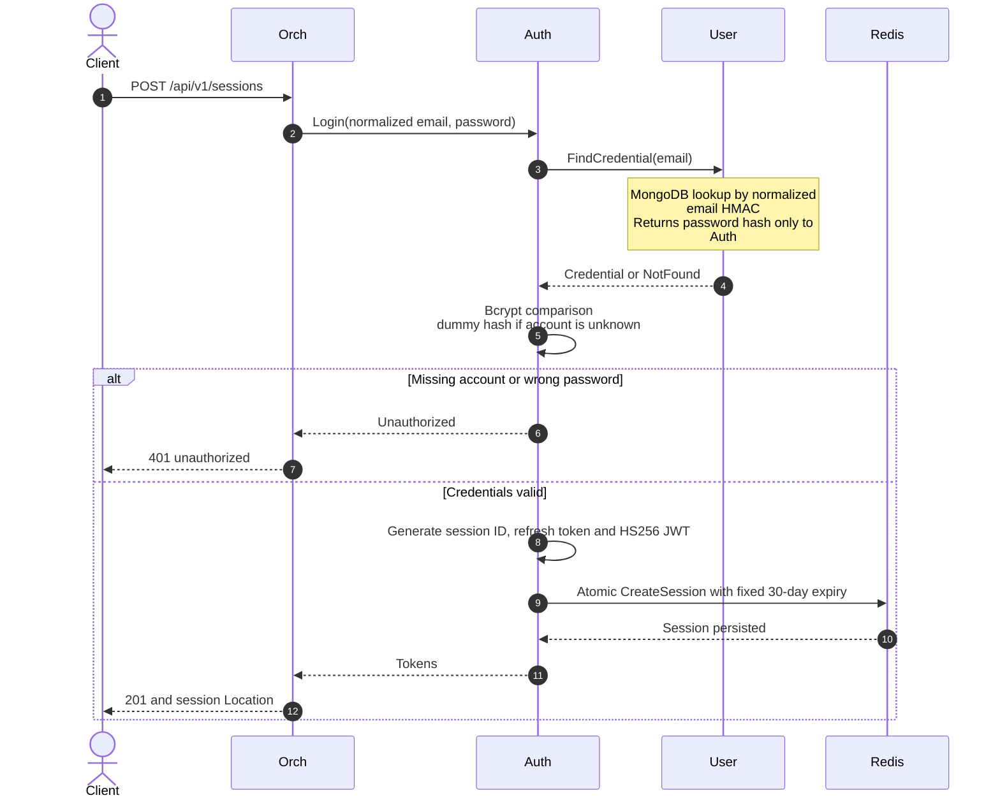

Access JWT lifetime defaults to 15 minutes. Sessions expire after 30 days and are limited to 100 active sessions per user. Redis rejection/failure returns no tokens.

<a id="current-profile"></a>

### GET /api/v1/users/me — Current profile

**Auth:** Bearer. **Response:** 200, `data: User`. **Errors:** 401 authentication, 404 account removed between checks, 503/504 dependency failure.

```sh
curl -i "$BASE/api/v1/users/me" -H "Authorization: Bearer $ACCESS_TOKEN"
```

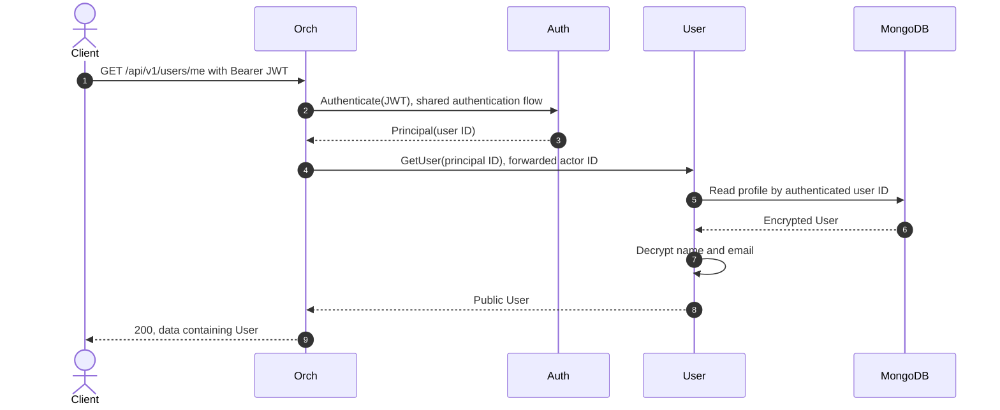

The account read during authentication and the profile read are separate. Public responses never contain `password_hash`.

<a id="get-user"></a>

### GET /api/v1/users/{id} — Get user

**Auth:** Bearer; authenticated users may read another user’s public profile. **Path:** 32-character hexadecimal ID. **Response:** 200, `data: User`. **Errors:** 400 ID, 401 authentication, 404 target missing, 503/504 dependency failure.

```sh
curl -i "$BASE/api/v1/users/$USER_ID" -H "Authorization: Bearer $ACCESS_TOKEN"
```

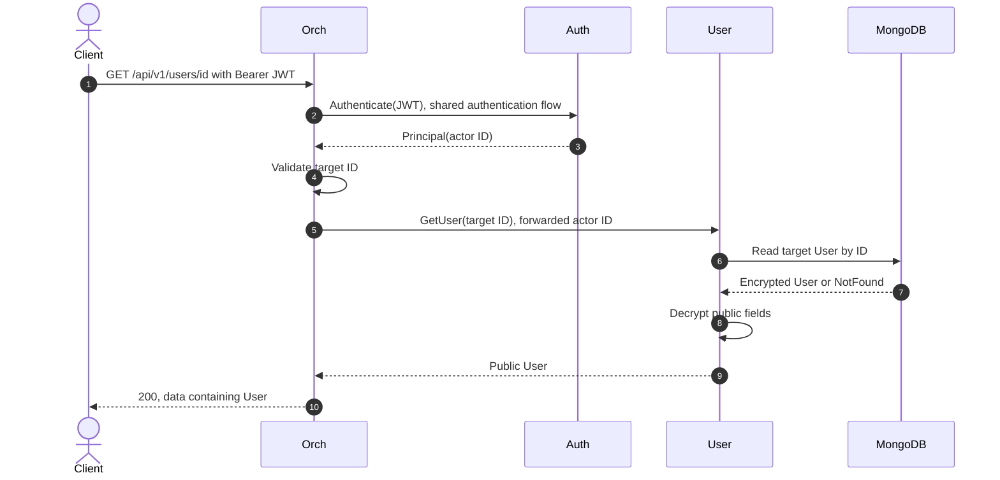

<a id="list-users"></a>

### GET /api/v1/users — List users

**Auth:** Bearer. **Query:** `limit` 1–100 (default 20), optional hexadecimal `after` cursor. **Response:** 200, `data: {users: User[], next_cursor?: string}`. **Errors:** 400 query, 401 authentication, 503/504 dependency failure.

```sh
curl -i "$BASE/api/v1/users?limit=20" -H "Authorization: Bearer $ACCESS_TOKEN"
curl -i "$BASE/api/v1/users?limit=20&after=$USER_ID" -H "Authorization: Bearer $ACCESS_TOKEN"
```

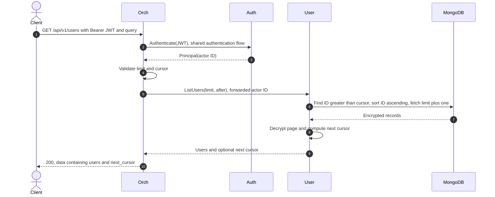

`next_cursor` is the last returned ID when another page exists. It is omitted on the final page. An empty result returns `{"data":{"users":[]}}`.

<a id="update-user"></a>

### PATCH /api/v1/users/{id} — Update own user

**Auth:** Bearer and owner. **Request:** at least one of `name`, `email`. **Response:** 200, `data: User`. **Errors:** 400 ID/body, 401 authentication, 403 owner mismatch, 404 target missing, 409 duplicate email, 503/504 dependency or transaction failure.

```sh
curl -i -X PATCH "$BASE/api/v1/users/$USER_ID" \
  -H "Authorization: Bearer $ACCESS_TOKEN" -H 'Content-Type: application/json' \
  -d '{"name":"Alice Updated","email":"alice.updated@example.com"}'
```

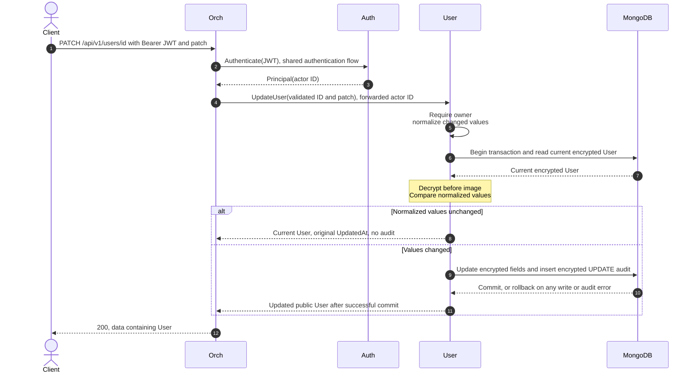

Missing fields remain unchanged. A real change advances `updated_at`; `created_at` is preserved. Audit failure rolls back the User write. MongoDB transaction retries re-read the current record.

<a id="delete-user"></a>

### DELETE /api/v1/users/{id} — Delete own user

**Auth:** signed, unexpired Bearer JWT with owner ID. **Response:** 204, empty body. **Errors:** 400 ID, 401 JWT/session when account exists, 403 owner mismatch, 503/504 transaction or revocation failure.

```sh
curl -i -X DELETE "$BASE/api/v1/users/$USER_ID" -H "Authorization: Bearer $ACCESS_TOKEN"
```

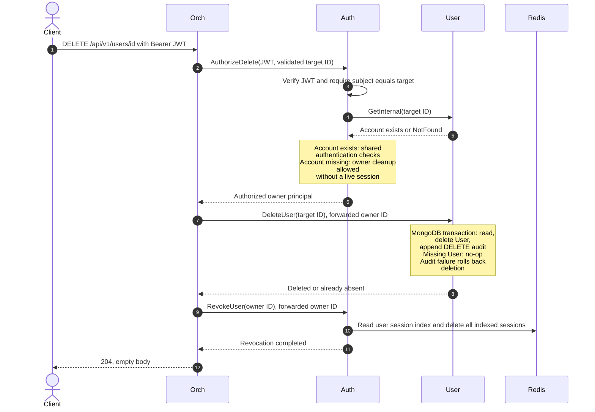

User deletion and Redis cleanup are separate operations. If cleanup fails after deletion, retry with the same unexpired owner JWT. The retry creates no duplicate DELETE audit; an expired JWT returns 401.

<a id="refresh"></a>

### POST /api/v1/sessions/current/tokens — Refresh

**Request:** `{refresh_token}`; no Bearer header. **Response:** 200, `data: Tokens`. **Errors:** 400 body, 401 invalid/reused/expired token or deleted account, 503/504 dependency failure.

```sh
curl -i "$BASE/api/v1/sessions/current/tokens" -H 'Content-Type: application/json' \
  -d "{\"refresh_token\":\"$REFRESH_TOKEN\"}"
```

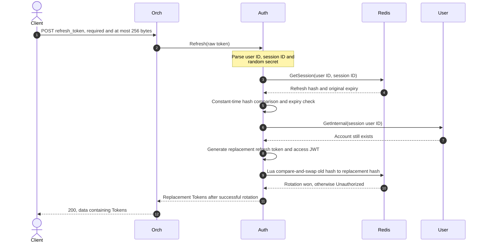

Replace both stored tokens with the response values. Concurrent reuse has one winner; other requests return 401. Rotation preserves the original session ID and 30-day expiry.

<a id="logout"></a>

### DELETE /api/v1/sessions/current — Logout

**Auth:** signed, unexpired Bearer JWT. **Response:** 204, empty body. **Errors:** 401 missing/invalid/expired JWT, 503/504 Redis failure.

```sh
curl -i -X DELETE "$BASE/api/v1/sessions/current" -H "Authorization: Bearer $ACCESS_TOKEN"
```

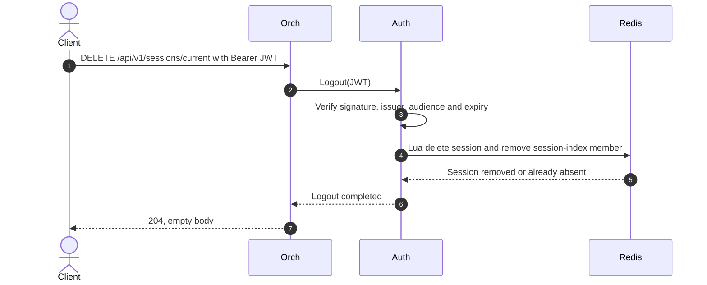

Logout does not require a profile lookup or an existing live session. A repeat logout with a still-valid signed JWT returns 204; later protected requests with that session return 401.

<a id="liveness"></a>

### GET /healthzc — Liveness

**Auth:** public. **Alias:** `/healthz`. **Response:** 200, `{"data":{"status":"alive"}}`. No dependency checks.

```sh
curl -i "$BASE/healthzc"
curl -i "$BASE/healthz"
```

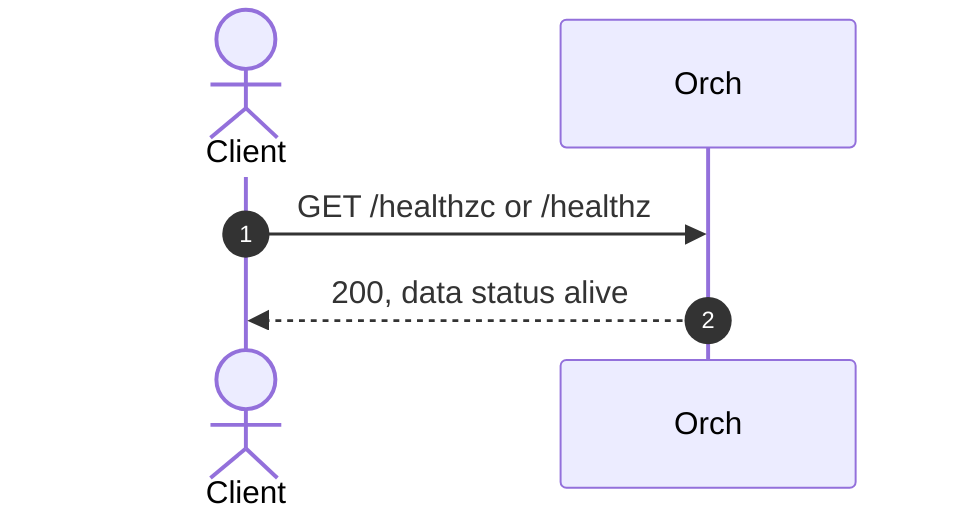

<a id="readiness"></a>

### GET /readyz — Readiness

**Auth:** public. **Response:** 200, `{"data":{"status":"ready"}}`; 503, `service_unavailable` if a Core probe fails or does not report SERVING.

```sh
curl -i "$BASE/readyz"
```

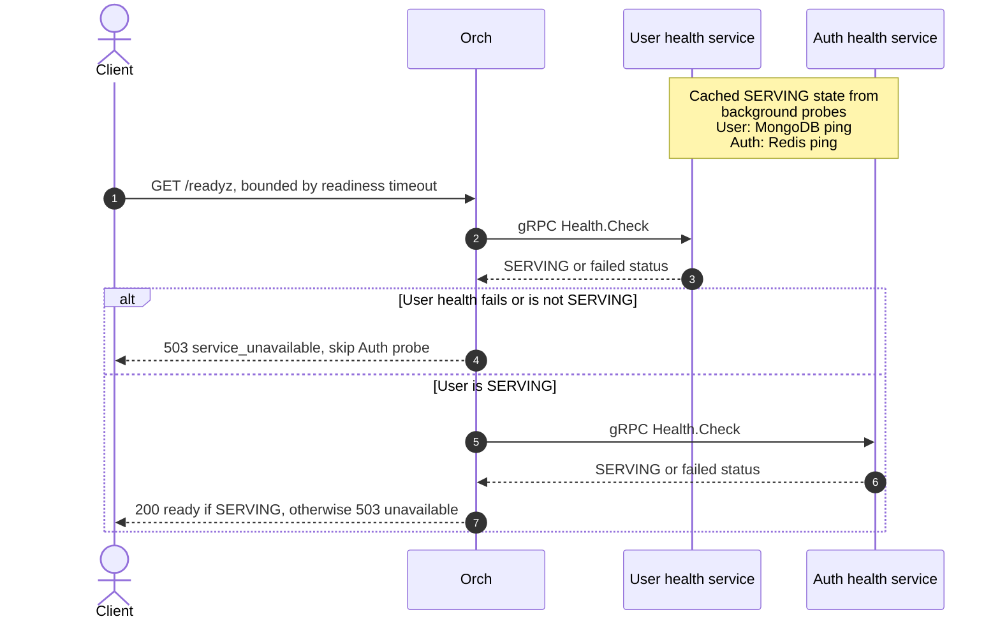

Readiness uses the gRPC health state maintained by each Core’s background probe; it does not query MongoDB/Redis directly per HTTP request. HTTP and gRPC health probes are excluded from access logs.
