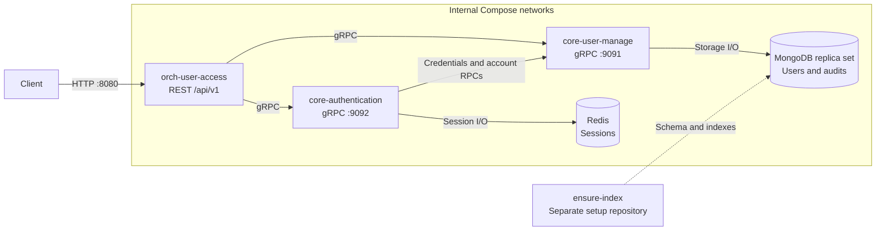
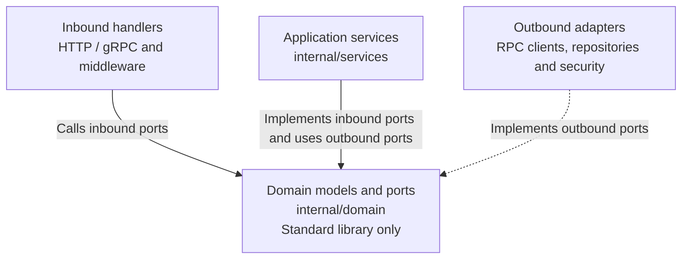

# Architecture

## 1. Service architecture

| Service | Owns |
|---|---|
| [orch-user-access](../orch-user-access/README.md) | REST validation, authentication middleware and orchestration |
| [core-authentication](../core-authentication/README.md) | Credential verification, JWT and Redis sessions |
| [core-user-manage](../core-user-manage/README.md) | User CRUD, encrypted MongoDB records, audit and count worker |

`ensure-index` is a separate repository and explicit setup job. It creates schema/indexes before first startup; runtime services do not run it.

## 2. Hexagonal dependency direction

Arrows show code dependencies, not network request order. Dashed arrows indicate interface implementation.

| Service | Inbound port | Outbound ports |
|---|---|---|
| Orch | `UserAccessService` | `CoreUserAdapter`, `CoreAuthenticationAdapter` |
| Authentication | `AuthenticationService` | `CoreUserAdapter`, `SessionRepository`, `AuthenticationSecurityAdapter` |
| User | `UserService` | `UserRepository`, `UserAuditRepository`, `TransactionManager`, `PasswordHasher`, `SensitiveDataCipher`, `EmailLookupHasher` |

`cmd` wires implementations. Domain ports stay independent of Gin, gRPC, BSON and database drivers; application services depend on those ports. `pkg` is copied per module; no service imports another service's implementation.

## Current limitations

Core gRPC trusts forwarded metadata and relies on private network access. The local MongoDB/Redis deployment has no high availability; tracing has no external collector.

[API specification and sequences](api.md) · [Setup](getting-started.md)
