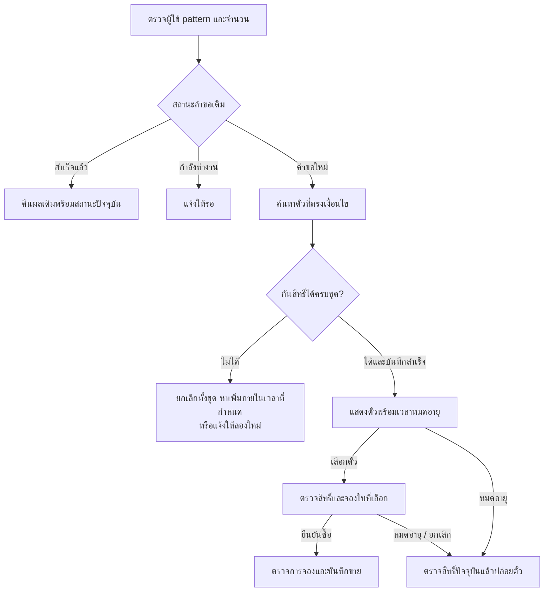

# 01 — วิเคราะห์โจทย์และ Flow

## โจทย์และขอบเขต

ระบบต้องค้นหาลอตเตอรี่ 10 ล้านใบขึ้นไปด้วย pattern 6 ตัว โดย `*` แทนเลขหนึ่งหลัก และป้องกันการคืนตั๋วใบเดียวกันให้หลายคนพร้อมกัน

| Pattern | ค้นหา |
|---|---|
| `****23` | ลงท้ายด้วย 23 |
| `1****5` | ขึ้นต้นด้วย 1 ลงท้ายด้วย 5 |
| `123***` | ขึ้นต้นด้วย 123 |
| `*2*4**` | หลักที่ 2 เป็น 2 และหลักที่ 4 เป็น 4 |
| `******` | ทุกเลข โดยจำกัดจำนวนผลลัพธ์ |

เลข 6 หลักมีเพียงหนึ่งล้านค่า ตั๋ว 10 ล้านใบจึงมีเลขซ้ำได้ ต้องแยก `ticket_id` ของแต่ละใบและเก็บเลขให้ครบ 6 หลัก รวมศูนย์ด้านหน้า การป้องกันซ้ำยึดตัวตั๋ว และครอบคลุม pattern ที่ทับซ้อนกันด้วย เช่น `****23` กับ `1****3` ต่างค้นเจอ `100023`

แนวทางนี้กันสิทธิ์ตั้งแต่แสดงผล คนอื่นจึงไม่ได้ตั๋วใบเดียวกันระหว่างที่สิทธิ์ยังมีผล หน้าจอที่ค้างอาจยังแสดงภาพเดิมได้ แต่จะใช้สิทธิ์ที่หมดอายุทำรายการต่อไม่ได้

## กติกาที่ใช้ในการออกแบบ

จำนวนและเวลาต่อไปนี้เป็นสมมติฐาน สามารถปรับหลังทราบโหลดจริง

| เรื่อง | กติกา |
|---|---|
| ผลค้นหา | ตัวอย่างครั้งละ 10 ใบ ต้องได้ครบหรือไม่จัดสรรเลย และจำกัดจำนวนสูงสุด |
| สิทธิ์แสดงผล | 15 วินาที นับจากเวลาที่ server กำหนด |
| เลือกตั๋ว | จองเฉพาะใบที่เลือก 120 วินาที ใบที่เหลือหมดสิทธิ์ตามเวลาเดิม |
| ซื้อ | ตรวจเจ้าของและการจองที่ยังมีผลก่อนบันทึกการขาย |
| หมดอายุ / ยกเลิก | ปล่อยเฉพาะสิทธิ์ปัจจุบันที่ตรวจผ่าน |
| ค้นหาใหม่ | เป็นคำขอใหม่ ต้องจำกัดจำนวนชุดและการจองค้างต่อผู้ใช้ |
| ส่งคำขอซ้ำ | ใช้ idempotency key เดิม คืนผลเดิมพร้อมสถานะปัจจุบัน ไม่เพิ่มตั๋วหรือต่อเวลา |
| Key เดิมแต่ข้อมูลเปลี่ยน | ปฏิเสธคำขอ |

ตัวอย่าง ผู้ใช้ได้ผลค้นหา 10 ใบแล้วเลือก 2 ใบ ระบบจอง 2 ใบนั้นให้ 120 วินาที ส่วนอีก 8 ใบหมดสิทธิ์เมื่อครบเวลาแสดงผลเดิม ขอบเขตนี้ครอบคลุมการบันทึกขาย ส่วนการเชื่อมผู้ให้บริการชำระเงินออกแบบแยก

## Flow การทำงาน

การกันสิทธิ์และบันทึกผลต้องสำเร็จพร้อมกันทั้งชุดก่อนตอบผู้ใช้ เช่นเดียวกับการเลือกหลายใบ หากตรวจสิทธิ์ไม่ผ่านให้ปฏิเสธรายการ งานปล่อยสิทธิ์ทำฝั่งระบบแม้ผู้ใช้ปิดแอป และส่งต่อสถานะไปยังข้อมูลช่วยค้นหาเฉพาะหลังบันทึกสำเร็จ

## เงื่อนไข

- ตั๋วหนึ่งใบมีผู้ถือสิทธิ์ที่ยังมีผลได้เพียงคนเดียว ตรวจจากสถานะหลักก่อนทำรายการเสมอ
- คำขอที่ timeout ต้องตรวจผลด้วย key เดิม เพราะอาจบันทึกสำเร็จแล้วแต่ response หาย
- ตรวจเจ้าของ รหัสสิทธิ์ปัจจุบัน และเวลาฝั่งระบบหลังได้สิทธิ์แก้ไขข้อมูล งานเก่าต้องไม่ล้างสิทธิ์ของคนใหม่
- เมื่อ failover ต้องรักษารายการที่ตอบสำเร็จแล้วและหยุดผู้ประมวลผลเก่า หากยืนยันไม่ได้ให้หยุดจัดสรร
- ข้อมูลช่วยค้นหาอาจล่าช้าได้ แต่ต้องส่งซ้ำได้และไม่ให้ข้อมูลเก่าทับข้อมูลใหม่

## ขนาดข้อมูลและโหลด

10 ล้านใบบอกขนาดข้อมูล แต่ยังใช้รับรองความเร็วไม่ได้ ต้องทราบจำนวนคำขอต่อวินาที เวลาตอบที่ยอมรับได้ และสัดส่วนตั๋วว่างก่อน

หากเลขกระจายสม่ำเสมอ `****23` จะตรงประมาณ 100,000 ใบ เมื่อแจกครั้งละ 10 ใบ จึงรองรับผู้ถือผลครบชุดพร้อมกันได้ไม่เกิน 10,000 คน ก่อนหักใบที่จองหรือขายแล้ว

ระบบจึงต้องอ่านเป็นชุด กระจายจุดเริ่ม และจำกัดจำนวนครั้งที่ลอง เวลารวม และคิวงาน หากค้นไม่ครบภายในงบงานให้แจ้งว่าจัดสรรไม่สำเร็จ ยังสรุปว่าตั๋วหมดไม่ได้

รายละเอียดเทคโนโลยีและวิธีทดสอบอยู่ใน [เอกสาร 02](README.02.modules.md)
