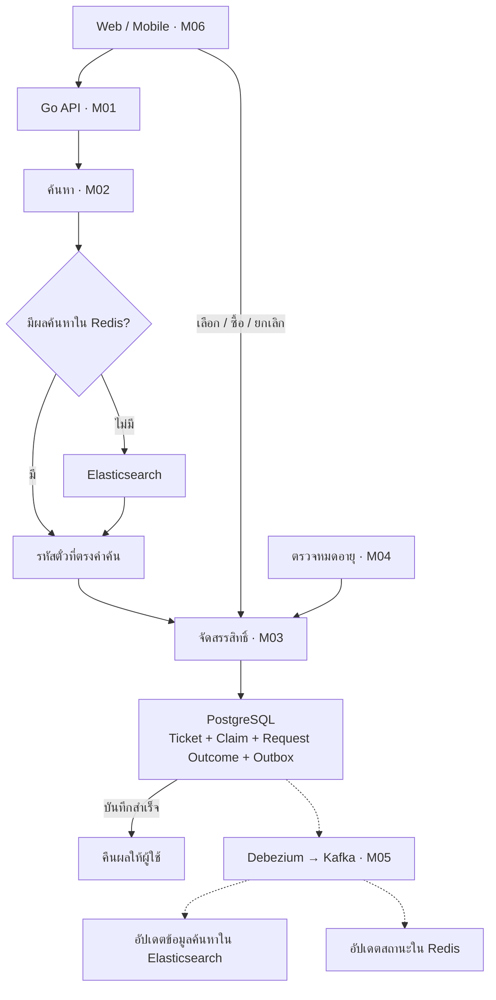

# 02 — ออกแบบระบบ

ต่อจาก [การวิเคราะห์โจทย์](README.01.analysis.md) ระบบนี้ใช้ PostgreSQL ตรวจและบันทึกสิทธิ์ตั๋ว ส่วน Elasticsearch ใช้ค้นหาเลขที่มี `*` ได้ทุกตำแหน่ง

## ส่วนประกอบและเหตุผลที่เลือก

| ส่วน | หน้าที่ |
|---|---|
| M01 รับคำขอค้นหา | ตรวจผู้ใช้ คำค้น และผลคำขอเดิม แล้วเรียกส่วนค้นหาและจัดสรรตั๋ว |
| M02 ค้นหา | หารหัสตั๋วที่ตรงคำค้นจาก Elasticsearch และ Redis |
| M03 จัดสรรสิทธิ์ | กันตั๋ว จอง ขาย และคืนตั๋วให้ว่างผ่าน PostgreSQL |
| M04 ตรวจหมดอายุ | หาตั๋วที่สิทธิ์หมดอายุ แล้วส่งให้ส่วนจัดสรรตรวจและคืนตั๋ว |
| M05 ส่งต่อสถานะ | อัปเดตข้อมูลค้นหาและ cache ตามสถานะล่าสุด |
| M06 หน้าจอ | แสดงผล รับการเลือกและซื้อ พร้อมปิดการเลือกเมื่อหมดเวลา |

แบ่งส่วนตามหน้าที่ โดยติดตั้งรวมกันได้ ใช้ Go เขียน API และงานเบื้องหลัง ส่วนเครื่องมือหลักเลือกดังนี้

| เทคโนโลยี | เหตุผล | สิ่งที่ต้องดูแล |
|---|---|---|
| PostgreSQL | บันทึกสิทธิ์หลายใบและผลคำขอให้สำเร็จพร้อมกันด้วย transaction, การล็อกแถว และกฎในฐานข้อมูล | งานเขียนข้อมูลและบันทึกการเปลี่ยนแปลง (WAL) ทุกครั้งที่ค้นสำเร็จ |
| Elasticsearch | มีดัชนีค้นเลขตามตำแหน่ง และเพิ่มเครื่องรองรับการค้นหาแยกจากงานจองได้ | กลุ่มเครื่องและข้อมูลที่อาจอัปเดตช้ากว่าฐานข้อมูลหลัก |
| Redis Cluster | เก็บผลค้นหาและสำเนาสถานะ ลดการค้นซ้ำ | หน่วยความจำและอายุข้อมูลที่เก็บ (TTL) |
| Debezium / Kafka Connect | อ่านรายการเปลี่ยนแปลงที่บันทึกสำเร็จแล้วจาก outbox | ตัวเชื่อมต่อและ WAL ที่สะสมระหว่างส่งข้อมูลไม่ทัน |
| Kafka | ส่งการเปลี่ยนแปลงให้ส่วนค้นหาและ cache อ่านแยกกันหรืออ่านย้อนหลังได้ | เครื่องรับส่งข้อมูล ระยะเวลาเก็บ และงานที่ยังอ่านไม่ทัน |

การแยกงานช่วยให้เพิ่มกำลังแต่ละส่วนได้ แต่มีระบบให้ดูแลมากขึ้น หากมีคำขอไม่มาก การเริ่มด้วย PostgreSQL อย่างเดียวจะง่ายกว่า แบบนี้เลือกแยกงานค้นหา cache และการส่งต่อสถานะ โดยให้ PostgreSQL ตัดสินสิทธิ์ทั้งหมด

## การทำงานหลัก

เส้นประเป็นงานหลังบันทึกสำเร็จ จึงตอบผู้ใช้ได้โดยไม่รออัปเดตสำเนา ทุกใบที่คืนผลต้องกันสิทธิ์ใน PostgreSQL ก่อน แม้จะอ่านผลค้นหาจาก cache

## ค้นหาและอ่าน cache

Elasticsearch เก็บตั๋วแต่ละใบด้วย `(draw_id, ticket_id)` แยกเลขเป็น `d1–d6` ชนิด `keyword` พร้อม `number`, `state`, `version` และกลุ่มตั๋ว (bucket) การค้น `****23` ใช้ `d5 = 2 AND d6 = 3` ส่วนหลักที่เป็น `*` ไม่ต้องใส่เงื่อนไข จึงไม่ต้องสร้างทุกคำค้นล่วงหน้าหรือใช้คำสั่ง wildcard ของ Elasticsearch

| Cache | ใช้อะไรระบุรายการ | ข้อมูลที่เก็บ |
|---|---|---|
| ผลค้นหา | งวด + คำค้น + กลุ่มตั๋ว + ตำแหน่งอ่านต่อ (cursor) | รหัสตั๋ว เช่นชุดละ 50 ใบ ตำแหน่งอ่านชุดถัดไป และ TTL |
| สถานะ | งวด + รหัสตั๋ว | สถานะ รหัสสิทธิ์ เวลาหมดอายุ version และ TTL |

ถ้าไม่มีผลค้นหาใน cache หรือ TTL หมด ให้ค้น Elasticsearch แล้วเก็บผลพร้อมตำแหน่งอ่านต่อ รายการที่เก็บไว้แต่ไม่มีตั๋วก็ถือว่ามี cache ส่วนสำเนาสถานะช่วยข้ามใบที่มีคนถือสิทธิ์ จอง หรือขายแล้ว หากไม่มีสถานะหรือสิทธิ์หมดอายุ ให้ฐานข้อมูลตรวจอีกครั้ง

Cache ผลค้นหาเก็บว่าตั๋วตรงคำค้น จึงไม่ต้องไล่ลบรหัสตั๋วจากทุกคำค้นเมื่อมีคนจอง อายุ cache แยกจากอายุสิทธิ์ การล้าง cache ไม่ได้คืนตั๋วให้ว่าง

หากได้ตั๋วไม่ครบ ให้รวบรวมรหัสจากชุดถัดไปแล้วลองจัดสรรจากรายการที่สะสมไว้ จำกัดจำนวนรหัส จำนวนรอบ และเวลารวม แต่ละรอบตรวจสถานะใหม่ หากไม่ครบให้ยกเลิกการเปลี่ยนแปลงทั้งชุด ระหว่างค้นหาไม่ล็อกแถวในฐานข้อมูล และใช้ตำแหน่งอ่านต่อเพื่อไม่ดึงรหัสเดิมซ้ำ

## กันตั๋ว จอง และขาย

เริ่ม transaction ด้วยการบันทึกรหัสคำขอ `(user_id, operation, idempotency_key)` ซึ่งฐานข้อมูลห้ามซ้ำ หากมีคำขอเดิมอยู่แล้ว ให้รอภายในเวลาที่กำหนดหรือแจ้งว่ายังทำงานอยู่ จากนั้นอ่านผลที่บันทึกสำเร็จด้วยคำสั่งอ่านใหม่ ถ้าใช้รหัสเดิมแต่ข้อมูลคำขอเปลี่ยน ให้ปฏิเสธโดยเทียบ fingerprint หรือค่าที่ใช้ตรวจว่าข้อมูลตรงกัน

| รายการ | การเปลี่ยนสถานะ |
|---|---|
| แสดงผล | ล็อกใบที่ `AVAILABLE` ด้วย `FOR UPDATE SKIP LOCKED` แล้วเปลี่ยนเป็น `DISPLAY_HELD` 15 วินาที |
| เลือกตั๋ว | หลังล็อกแถว ตรวจว่าเป็น `DISPLAY_HELD` ของผู้ใช้และยังไม่หมดอายุ แล้วเปลี่ยนใบที่เลือกเป็น `RESERVED` 120 วินาที |
| ซื้อ | ตรวจว่าเป็น `RESERVED` ของผู้ใช้และยังไม่หมดอายุ แล้วเปลี่ยนเป็น `SOLD` |
| หมดอายุ / ยกเลิก | ตรวจสถานะ รหัสสิทธิ์ปัจจุบัน และเงื่อนไขหมดอายุหรือสิทธิ์ยกเลิก แล้วเปลี่ยนเป็น `AVAILABLE` |

การกันตั๋วและเลือกหลายใบต้องสำเร็จทั้งชุด บันทึกสถานะ ผลคำขอ และรายการส่งต่อสถานะ (outbox) ใน transaction เดียวก่อนตอบสำเร็จ การส่งคำขอเดิมซ้ำไม่เพิ่มตั๋วหรือเริ่มเวลาใหม่ หากรอจนหมดเวลาแล้วยังไม่ทราบผล ให้ตรวจด้วยรหัสคำขอเดิม

เมื่อเลือกบางใบ ให้สร้างสิทธิ์จองใหม่และย้ายเฉพาะใบที่เลือก ใบที่เหลือหมดอายุตามเวลาเดิม งานคืนตั๋วจากสิทธิ์แสดงผลเก่าจึงไม่ยกเลิกการจองใหม่ ส่วนงานตรวจหมดอายุจะอ่านทีละชุดโดยใช้เวลาฐานข้อมูล ไม่รอให้หน้าจอแจ้ง

## ข้อมูลที่เก็บและดัชนีค้นหา

| ข้อมูล | รายละเอียดหลัก |
|---|---|
| Ticket — ตั๋ว | รหัสหลัก `(draw_id, ticket_id)`; เลข 6 หลัก สถานะ รหัสสิทธิ์ปัจจุบัน เวลาหมดอายุ และ version |
| Claim — สิทธิ์ | รหัสหลัก `claim_id`; ผู้ใช้ งวด ประเภท และเวลาหมดอายุ; มีดัชนีตามผู้ใช้และงวด |
| Claim Item — ตั๋วในแต่ละสิทธิ์ | ห้ามซ้ำในชุด `(claim_id, draw_id, ticket_id)` และอ้างอิง Claim/Ticket ด้วย foreign keys; ตั๋วมีประวัติได้หลายสิทธิ์ |
| Request Outcome — ผลคำขอ | ห้ามซ้ำในชุด `(user_id, operation, idempotency_key)`; เก็บ fingerprint และผลเดิมที่อ้างอิงสิทธิ์ |
| Outbox — รายการรอส่งต่อ | รหัสหลัก `event_id`; งวด รหัสตั๋ว version สถานะ รหัสสิทธิ์ และเวลาหมดอายุ |

เพิ่มดัชนี `(expires_at, draw_id, ticket_id)` เฉพาะสถานะ `DISPLAY_HELD` และ `RESERVED` เพื่อให้งานตรวจหมดอายุค้นได้เร็ว สิทธิ์ปัจจุบันดูจาก `Ticket.current_claim_id` ร่วมกับสถานะและเวลาหมดอายุ การมีชื่อใน Claim Item เก่าไม่ได้แปลว่ายังมีสิทธิ์

## อัปเดตข้อมูล

PostgreSQL เก็บสถานะจริงของตั๋ว ส่วน Elasticsearch และ Redis เก็บข้อมูลไว้ช่วยค้นหา เมื่อสถานะตั๋วเปลี่ยน ต้องส่งไปอัปเดตทั้งสองที่ด้วย

ตัวอย่าง เมื่อ A จองตั๋ว PostgreSQL จะบันทึกก่อน แล้วจึงส่งสถานะไปยังส่วนค้นหา หากอัปเดตช้า B อาจยังค้นเจอตั๋วใบนั้น แต่ PostgreSQL จะไม่ให้สิทธิ์ซ้ำกับ A

การส่งข้อมูลทำตามลำดับนี้:

1. บันทึกสถานะตั๋วและรายการรอส่ง (outbox) ให้สำเร็จพร้อมกัน
2. Debezium อ่านรายการที่บันทึกแล้วส่งเข้า Kafka โดยใช้รหัสงวดและตั๋วเป็น key
3. แยกกลุ่มอ่านให้ Elasticsearch และ Redis เพื่อให้ทั้งคู่ได้รับข้อมูล ยืนยันว่าอ่านแล้วเมื่ออัปเดตสำเร็จ หากยังไม่สำเร็จให้ลองใหม่
4. ตรวจเลขลำดับการเปลี่ยนแปลง (`version`) ก่อนอัปเดต เพื่อไม่ให้ข้อมูลเก่าหรือข้อมูลซ้ำทับข้อมูลใหม่

## จะทดสอบอย่างไร

จำนวนตั๋ว 10 ล้านใบยังบอกไม่ได้ว่ารองรับผู้ใช้พร้อมกันได้เท่าไร ต้องดูจำนวนคำขอ รูปแบบที่ค้น และตั๋วที่ยังว่างด้วย

| งาน | สิ่งที่มีผลต่อความเร็ว |
|---|---|
| เตรียมข้อมูล | ต้องแยกเลขทั้ง 6 หลักและสร้างดัชนีให้ตั๋วทุกใบ |
| ค้นหา | จำนวนตั๋วที่ตรงคำค้นและจำนวนส่วนข้อมูลที่ต้องค้น |
| อ่านจาก cache | ลดงานค้นหา แต่ยังต้องตรวจและบันทึกสิทธิ์ใน PostgreSQL |
| กันตั๋ว | จำนวนใบที่ต้องตรวจและบันทึก รวมถึงการรอข้อมูลที่คนอื่นกำลังใช้งาน |
| ตั๋วใกล้หมด | อาจต้องตรวจหลายใบกว่าจะเจอใบว่าง จึงต้องจำกัดขนาดชุด เวลารวม และงานพร้อมกัน |

ถ้าเลขกระจายสม่ำเสมอ ในตั๋ว 10 ล้านใบ `****23` จะตรงประมาณ 100,000 ใบ, `123***` ประมาณ 10,000 ใบ และเลขตรงตัวประมาณ 10 ใบ ส่วน `******` ตรงทุกใบ แต่ระบบจะส่งกลับเฉพาะจำนวนที่ขอ

ในเชิงคำนวณ หากมีตั๋ว `N` ใบและระบุเลข `k` หลัก จะตรงประมาณ `N / 10^k` การแยกเลขใช้ O(6N) ส่วนการตรวจตั๋ว `C` ใบผ่านดัชนีประเมินได้คร่าว ๆ เป็น O(C log N) แล้วยังมีงานเขียนสิทธิ์เพิ่ม เวลาจริงต้องวัดจากระบบ

ตัวอย่าง หากค้นสำเร็จ 1,000 ครั้ง/วินาที ครั้งละ 10 ใบ:

- บันทึกสิทธิ์แสดงผล 10,000 ใบ/วินาที
- ถ้าทุกชุดหมดอายุ จะมีงานคืนตั๋วอีก 10,000 ใบ/วินาที และ outbox รวมราว 20,000 รายการ/วินาที
- ถ้าถือสิทธิ์ครบ 15 วินาที จะมีตั๋วถูกกันไว้ประมาณ 150,000 ใบในช่วงที่โหลดคงที่

ตัวเลขนี้ยังไม่รวมการจอง ซื้อ และคำขอซ้ำ เป็นการคำนวณภาระงาน ไม่ใช่ผลทดสอบ
